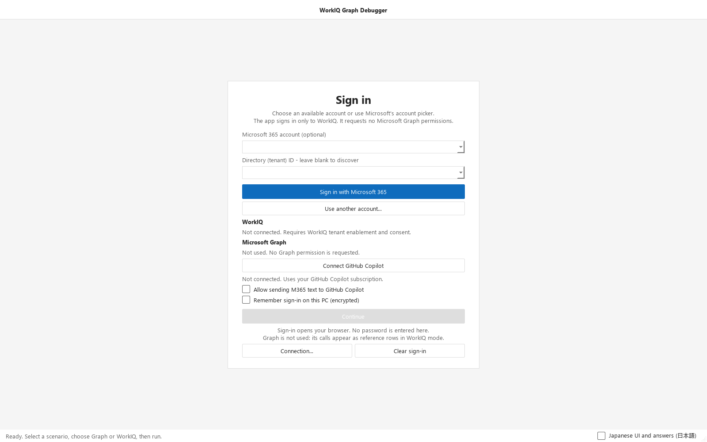
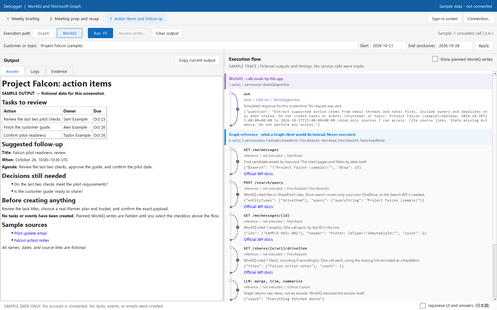

# WorkIQ vs Microsoft Graph

A GUI Application that shows WorkIQ calls beside Microsoft Graph API reference flows for Microsoft 365 tasks.

<table>
  <tr>
    <td align="center" width="50%">
      <a href="docs/screenshots/sign-in-english.png"></a><br>
      <sub>Sign-in screen</sub>
    </td>
    <td align="center" width="50%">
      <a href="docs/screenshots/action-items-english.png"></a><br>
      <sub>Action items with Graph reference calls</sub>
    </td>
  </tr>
</table>

*Screenshots use fictional sample data. Select an image to enlarge it.*

## Features

- Runs Microsoft 365 reads through WorkIQ and shows each call, permission, and timing.
- Shows the Microsoft Graph calls a client would need for the same task. These rows link to the official API docs and are never executed.
- Supports three scenarios: weekly briefing, meeting recap, and action items.
- Sends email or creates Planner tasks and a personal event only after you review and confirm the exact payload.
- Shows the interface and answers in Japanese by default. Clear the language checkbox for English.

## Quick start

```powershell
uv sync
uv run python desktop.py
```

Sign in with Microsoft 365, choose a scenario, enter a topic and a date window of up to 31 days (the end date is exclusive), then press `F5`.

## Writes

**Run never writes.** Use **Review writes...** to confirm a payload. Planned writes stay hidden unless **Show planned WorkIQ writes** is checked.

Writes are not retried or rolled back. After a partial failure or timeout, check Microsoft 365 before repeating.

## Privacy

- WorkIQ requires administrator consent for `WorkIQAgent.Ask`. The app requests no Graph permissions.
- **Remember sign-in** stores tokens encrypted for your Windows user. **Clear sign-in** deletes them.
- Account metadata and settings are saved in `.desktop-*.json`. Answers and logs may contain workplace data.
- `.gitignore` excludes local credentials and caches. It cannot detect secrets pasted into source code.

## Development

```powershell
uv run ruff check .
uv run python -m unittest discover -s test -p "test_desktop_*.py" -v
```

Tests use controlled responses and never sign in. The font-clipping check runs only with `QT_QPA_PLATFORM=windows`.

| Module | Purpose |
| --- | --- |
| `desktop.py` | Interface and event handling |
| `desktop_services.py` | WorkIQ, sign-in, and Copilot connections |
| `desktop_model.py` | Scenarios, run state, and write payloads |
| `desktop_reference.py` | Graph reference rows |

## Links

[WorkIQ setup](https://learn.microsoft.com/en-us/microsoft-365/copilot/extensibility/work-iq/enable-work-iq) · [WorkIQ tools](https://learn.microsoft.com/en-us/microsoft-365/copilot/extensibility/work-iq/mcp/tool-reference) · [Graph API](https://learn.microsoft.com/en-us/graph/api/overview)
